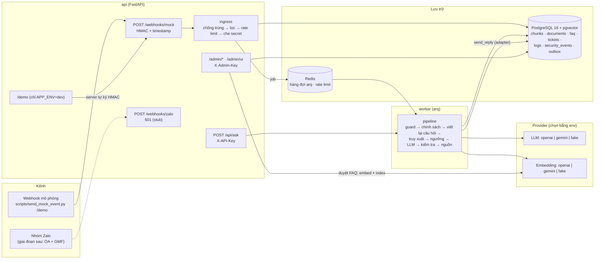
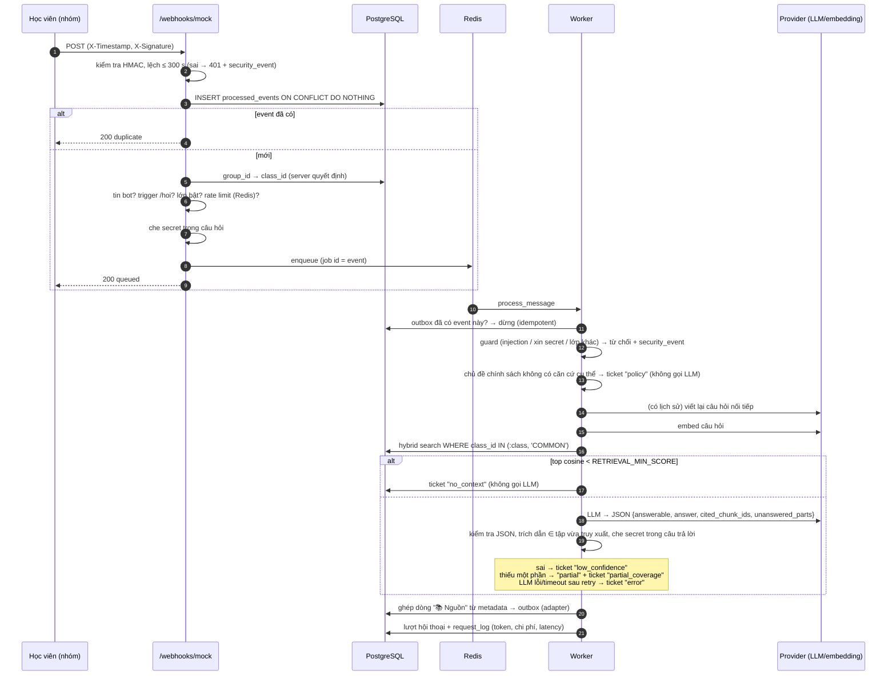
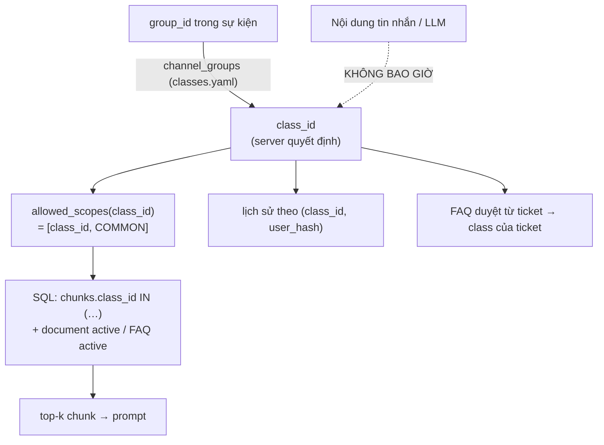
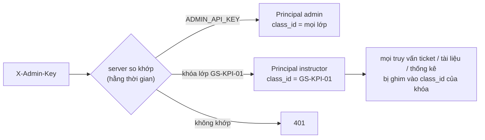
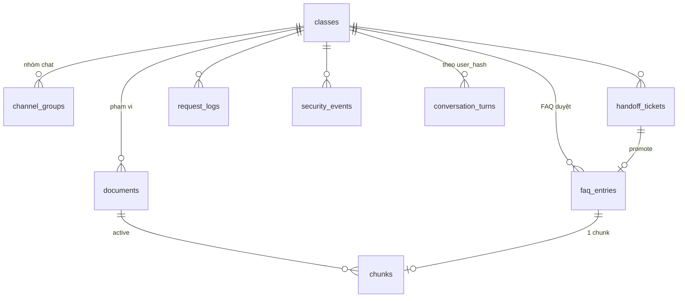

# Kiến trúc — GOS Academy AI Teaching Assistant (MVP)

Tài liệu này mô tả hệ thống **đúng như code hiện tại**. Lý do của từng lựa chọn nằm trong
[DECISIONS.md](DECISIONS.md) (mã `D-xx` được nhắc trong ngoặc).

## 1. Thành phần

| Thành phần | Thư mục | Vai trò |
|---|---|---|
| Channel adapter | `app/channels/` | `ChannelAdapter` (verify, parse, send_reply). `MockWebhookAdapter` ghi tin "đã gửi" vào `outbox`; `ZaloGMFAdapter` là khung, các hàm ném `NotImplementedError`. |
| Ingress | `app/channels/ingress.py` | Phần đồng bộ (< 300 ms): chống trùng, bỏ tin bot/không trigger/nhóm lạ/lớp tắt, rate limit, che secret, đưa vào hàng đợi. |
| Pipeline | `app/agent/` | Phần bất đồng bộ: guard, chính sách, viết lại câu hỏi, gọi LLM, kiểm tra, ticket, ghép nguồn, ghi log. |
| Kho tri thức | `app/ingestion/` | Parse DOCX/PDF/XLSX → chunk theo cấu trúc → phân phạm vi theo mã mục → embed → swap version. |
| Truy xuất | `app/retrieval/search.py` | Hybrid vector + full-text, gộp bằng RRF, **bắt buộc `class_id`**. |
| Provider | `app/providers/` | Lớp trừu tượng cho LLM/embedding; `fake` tất định để test offline; retry/timeout tự viết. |
| Giám sát | `app/db/stats.py`, `app/core/pricing.py` | `/admin/stats`: token thật × đơn giá trong `pricing.yaml` (D-70). |

## 2. Luồng một tin nhắn

Các con số latency đo thật nằm trong [TEST_REPORT.md](TEST_REPORT.md).

## 3. Cách ly dữ liệu giữa các lớp (ràng buộc cứng số 2)

Có nhiều lớp phòng thủ chồng lên nhau, nên một lớp sai thì các lớp còn lại vẫn giữ an toàn:

1. **Xác định lớp:** `class_id` chỉ đến từ `(channel, group_id)` qua bảng `channel_groups`. Payload webhook không có trường lớp nào (D-06).
2. **Truy vấn:** `hybrid_search(…, class_id=…)` là tham số keyword-only, **không có mặc định**. `allowed_scopes` từ chối `COMMON` và id lạ. Bộ lọc nằm trong `WHERE` của cả nhánh vector lẫn full-text, kể cả khi tính IDF (D-49).
3. **Dữ liệu:** `chunks.class_id` được denormalize; mỗi bản ghi `documents` thuộc đúng một phạm vi; file trộn nhiều lớp được tách theo tiền tố mã mục (D-02).
4. **Kiểm tra sau LLM:** trích dẫn phải thuộc tập chunk vừa truy xuất (đã lọc theo lớp).
5. **Kiểm tra kiến trúc:** test liệt kê các module được phép dùng `Chunk`. Module mới phải được xem lại thì mới qua test.
6. **Đo đạc:** `eval_rag.py` đếm chunk lớp khác bị truy xuất và bị trích dẫn (kết quả thật: 0/0).

## 4. Vai trò & quyền

Có hai lớp phân quyền độc lập: **dữ liệu của bot** được cách ly theo lớp (mục 3, ràng buộc cứng số 2), và
**khu quản trị** được phân quyền theo người dùng (D-83). Vai trò luôn do server suy ra từ khóa, không bao giờ từ
điều client tự khai.

| Vai trò | Định danh | Được làm | Không được làm |
|---|---|---|---|
| **Học viên** | Không có khóa. Tài khoản chat → `user_hash` (HMAC), lớp suy ra từ `group_id` | Hỏi bot bằng `/hoi` trong nhóm của lớp mình; nhận câu trả lời của bot và của giảng viên | Chọn lớp; đọc tài liệu/ticket/thống kê; gọi bất kỳ API quản trị nào |
| **Giảng viên** | Khóa riêng của lớp trong `INSTRUCTOR_API_KEYS` (gửi qua `X-Admin-Key`) | Xem, trả lời, gửi vào nhóm, duyệt FAQ ticket **của lớp mình**; xem tài liệu lớp mình + COMMON; tải lên, xóa, đánh lại chỉ mục tài liệu **chỉ thuộc lớp mình**; xem thống kê lớp mình | Ticket/tài liệu lớp khác (trả **404**, không lộ sự tồn tại); lọc theo lớp khác (403); sửa tài liệu dùng chung COMMON; bật/tắt bot; xem sự kiện bảo mật; dùng `/demo` |
| **Quản trị** | `ADMIN_API_KEY` | Mọi lớp; bật/tắt bot; sự kiện bảo mật; tài liệu COMMON; trang `/demo` | — |
| **Hệ thống gọi `/api/ask`** | `ASK_API_KEY` (`X-API-Key`) | Hỏi đáp server-to-server, truyền `class_id` đã tự xác thực (D-57) | Mọi API quản trị |

- Cài đặt tại [app/api/deps.py](../app/api/deps.py): `require_staff` trả về `Principal(role, name, class_id)`,
  `require_admin` chặn thao tác toàn hệ thống. Khóa giảng viên được kiểm tra với `classes.yaml` lúc khởi động
  (sai mã lớp, trùng khóa, trùng khóa quản trị → app không khởi động).
- Khi giảng viên duyệt FAQ, `approved_by` lấy từ tên giảng viên trong `classes.yaml`, không lấy từ ô nhập.
- Giới hạn của MVP: một khóa cho mỗi lớp, chưa có tài khoản cá nhân, đăng nhập hay nhật ký thao tác theo người.
  Đề bài xếp phân quyền đầy đủ vào giai đoạn C; khi đó thay khóa bằng SSO/tài khoản, giữ nguyên `Principal`.

## 5. Ranh giới tin cậy & bảo mật

| Ranh giới | Cơ chế |
|---|---|
| Kênh → API | HMAC-SHA256 trên `"{ts}.{body}"`, lệch ≤ 300 s, `hmac.compare_digest`; sai thì trả 401 và ghi `security_events` (không lưu payload). |
| Quản trị | `X-Admin-Key` = khóa quản trị hoặc khóa giảng viên của một lớp (mục 4, D-83), so sánh hằng thời gian. Trang `/admin/ui` và `/demo` chỉ là vỏ tĩnh, không dùng cookie (D-63). CSP với nonce, dữ liệu chèn bằng `textContent` (D-64). |
| Server → server | `/api/ask` dùng `X-API-Key`, tin `class_id` do bên gọi đã xác thực truyền vào (D-57). |
| Dữ liệu người dùng | `user_hash = HMAC(user_id, USER_HASH_SALT)`. Không lưu tên hiển thị hay số điện thoại. Secret được che trước khi lưu, ghi log hoặc gửi LLM; câu trả lời của LLM và của giảng viên cũng được che. |
| Tài liệu → LLM | Tài liệu, lịch sử và câu hỏi được bọc trong thẻ và HTML-escape. Chunk có câu lệnh nhắm vào AI được đánh dấu `canh_bao` (D-50). Prompt yêu cầu coi chúng là DỮ LIỆU. |
| Log | JSON một dòng, có `request_id`. Không ghi payload, header xác thực, secret hay nội dung tin nhắn; với exception chỉ ghi tên lớp lỗi. |
| Zalo | Không dùng thư viện không chính thức. `/webhooks/zalo` trả 501 (ràng buộc cứng số 4). |

## 6. Mô hình dữ liệu (rút gọn)

- `documents`: version + `content_hash` theo phạm vi; trạng thái `processing → active`, bản cũ thành `superseded` và chunk cũ bị xóa trong cùng transaction (embed lỗi thì bản cũ vẫn `active`, D-41). Hash gồm cả `provider:model:dim` của embedding, nên đổi model sẽ tự embed lại (D-38).
- `processed_events (channel, event_id)` UNIQUE và unique một phần trên `outbox(channel, event_id)` bảo đảm mỗi event chỉ được trả lời một lần (D-17).
- Migration: `0001` (toàn bộ bảng + pgvector + HNSW + tsvector), `0002` (nguồn gốc tài liệu), `0003` (model embedding + token FAQ).

## 7. Triển khai

`docker compose up` khởi động `postgres` (pgvector), `redis`, `migrate` (chạy một lần: `alembic upgrade head` + đồng bộ `classes.yaml`), rồi `api` (có healthcheck `/health`) và `worker`. Cổng chỉ mở trên `127.0.0.1`. Container chạy bằng user thường, không phải root. Secret đọc từ `.env` (không commit).

Mở rộng khi cần:
- Tăng số `worker` (arq chia job qua Redis, job idempotent).
- Đổi provider bằng biến môi trường.
- Thêm kênh thật bằng cách viết một `ChannelAdapter` mới, không phải sửa pipeline.
